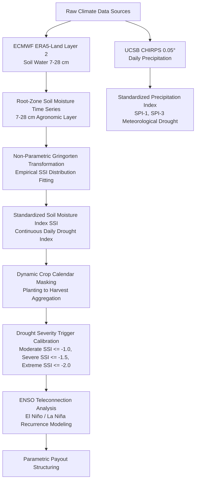

# Technical Methodology Guide: Parametric Drought Risk Modeling in Africa

> **Document Type**: Formal Technical Methodology & Scientific Reference Guide  
> **Location**: `Africa-Drought-Study/docs/DROUGHT_PARAMETRIC_METHODOLOGY_GUIDE.md`  
> **Project**: ASR Multi-Peril Parametric Insurance Research Study  
> **Target Audience**: Reinsurance Underwriters, Catastrophe Modelers, Quantitative Risk Analysts  
> **Version**: 2.0 (Non-Parametric Gringorten Empirical Transformation)  
> **Status**: Production & Handover Ready  

---

## 1. 📌 Executive Summary & Scope

Drought in sub-Saharan Africa is a slow-onset, multi-month catastrophe that devastates rainfed cereal production (maize, sorghum, millet, wheat). Traditional optical satellite vegetation indices (NDVI/EVI) suffer from **"greenness latency"**—they only detect crop failure 2–4 weeks *after* permanent wilting and physiological root necrosis have already occurred.

This document establishes the **ASR Parametric Drought Risk Model**, utilizing **ECMWF ERA5-Land Layer 2 root-zone soil water ($7-28\text{ cm}$)** and **CHIRPS high-resolution precipitation** transformed into the **Standardized Soil Moisture Index (SSI)** via **Non-Parametric Gringorten Empirical Transformations** across 1,600+ African agricultural districts over a 25-year baseline (2000–2025).



---

## 2. 🌾 Sensor Data Provenance & Physical Mechanisms

### 2.1 ERA5-Land Layer 2 Soil Water ($7 - 28\text{ cm}$)
- **Depth**: Subsurface root-zone layer ($7 - 28\text{ cm}$), where the primary root crown and lateral feeder roots of maize, sorghum, and millet extract water.
- **Advantage**: Detects agricultural moisture deficits **2 to 4 weeks earlier than NDVI**, capturing soil drought before leaf chlorosis and canopy brown-down occur.

### 2.2 Non-Parametric Gringorten Empirical Transformation
Rather than forcing a rigid parametric distribution (Gamma, Pearson Type III) that can distort dry-tail probabilities in semi-arid zones, the model computes the **Non-Parametric Standardized Soil Moisture Index (SSI)** using the **Gringorten plotting position formula**:

$$P(x_k) = \frac{k - 0.44}{N + 0.12}$$

Where:
- $k$: Rank of the historical soil moisture value $x_k$ across $N = 25$ years of historical baseline (2000–2025) for that specific day of the year.
- The empirical cumulative probability $P(x_k)$ is transformed into the standard normal distribution $Z \sim \mathcal{N}(0, 1)$:
  $$SSI = \Phi^{-1}\left( P(x_k) \right)$$

---

## 3. 🎯 Drought Severity Categorization & Payout Triggers

| Drought Category | Standardized Index ($SSI$) | Historical Cumulative Probability | Physical Crop Impact | Parametric Payout Structure |
| :--- | :---: | :---: | :--- | :---: |
| **Normal / Mild** | $SSI > -1.00$ | $P > 15.87\%$ | Normal vegetative growth; minor yield variance. | $0\%$ (Attachment Floor) |
| **Moderate Drought** | $-1.50 < SSI \le -1.00$ | $6.68\% < P \le 15.87\%$ | Stomatal closure, early leaf curling, 10–25% yield loss. | **$25\%$ of Total Sum Insured (TSI)** |
| **Severe Drought** | $-2.00 < SSI \le -1.50$ | $2.28\% < P \le 6.68\%$ | Tasseling/silking abortion, permanent wilting, 30–60% loss. | **$60\%$ of TSI** |
| **Extreme Drought** | $SSI \le -2.00$ | $P \le 2.28\%$ (1-in-44 Year Event) | Complete crop lodging, total harvest failure (>75% loss). | **$100\%$ of TSI (Exhaustion)** |

---

## 4. 📅 Dynamic Crop Calendar Synchronization

- **Calendar Provenance**: FAO and GEOGLAM regional crop calendars.
- **Cross-Year Season Preservation**: For Southern African agricultural regions where planting occurs in November and harvest completes in April/May, the pipeline aggregates across the active agronomic growth cycle without artificial December 31st calendar truncation.

---

## 5. 🌊 Climate Drivers: ENSO Teleconnection Analysis

- **Teleconnection Modeling**: Cross-correlating historical seasonal SSI time series with Oceanic Niño Index (ONI / Niño 3.4 SST anomalies).
- **Southern Africa (Mozambique, Zimbabwe, Zambia, South Africa)**: Strong negative correlation with El Niño ($r = -0.55 \text{ to } -0.72$), indicating severe multi-district drought risk during El Niño warm phases.
- **East Africa (Kenya, Ethiopia, Somalia)**: Positive correlation with El Niño (enhanced rainfall / flood risk) and strong drought association with La Niña cold phases.

---

## 6. 🗂️ Production Software Pipeline (`Africa-Drought-Study/`)

```
Africa-Drought-Study/
├── core_analysis/
│   ├── 01_extract_africa_drought_crop_calendar.py  # GEE ERA5-Land SSI Extraction
│   ├── 02_spatial_agglomerative_clustering.py     # Drought Risk Regionalization
│   ├── 03_enso_teleconnection_analysis.py         # ENSO Climate Driver Analysis
│   ├── 04_process_drought_history_2000_2025.py    # 25-Year Historical Drought Processor
│   ├── 05_merge_drought_days_to_gadm.py           # GADM Administrative Level 2 Merger
│   └── 06_evaluate_ssi_threshold_variations.py    # Sensitivity & Payout Trigger Engine
├── data/                                          # Shapefiles & Admin Boundaries
├── docs/                                          # Formal Methodology Guides
│   └── DROUGHT_PARAMETRIC_METHODOLOGY_GUIDE.md   # This Technical Methodology Guide
├── outputs/                                       # Dashboards & CSV Metrics
├── archive/                                       # Archived Exploratory Scripts
└── README.md                                      # Project Execution Guide
```
